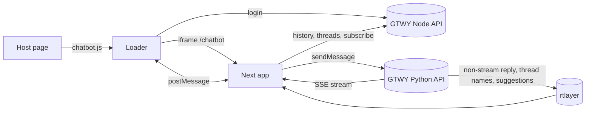

# Architecture

chatbot-ui is the GTWY AI chatbot that customers embed on their own sites. It has two halves:
- **Loader scripts** in `public/`, plain IIFEs served as static files and run on the customer's page.
- **The Next.js 15 iframe app** they open: React 19, Redux Toolkit with redux-persist, Tailwind, daisyUI and MUI.

The app has no server code of its own. Everything runs in the browser and calls the GTWY Node and Python backends, which live in other repos. It is deployed to Cloudflare Pages through `@cloudflare/next-on-pages`. The same app also serves the separate RAG knowledge-base embed (`/rag`, see [rag-embed](modules/rag-embed.md)).

## Entry point and startup

There is no server process to start. Execution begins on the customer's page:

1. The host page includes `<script id="chatbot-main-script" src=".../chatbot.js" embedToken="…">`. `public/chatbot.js` reads the tag's attributes, calls the GTWY login API, then creates the launcher button and an iframe at `/chatbot?interfaceDetails=<json>` ([embed-scripts](modules/embed-scripts.md)).
2. `app/layout.tsx` sets up the Redux `Provider`, `PersistGate` and `components/AppWrapper.tsx` (MUI theme and `ThemeContext`). It also loads the Tailwind Play CDN script.
3. `app/chatbot/layout.tsx` parses `interfaceDetails` into `ChatbotContext` and `appInfo`. `app/chatbot/page.tsx` stores the token, creates the tab id, and redirects to `/chatbot/<chatbot_id>`.
4. `components/Chatbot-Wrapper/ChatbotWrapper.tsx` mounts the host-message handlers and posts `interfaceLoaded`. The host answers with `interfaceData`, which carries the script attributes: `threadId`, `bridgeName`, `variables`, `config`, and so on.
5. `components/Chatbot/Chatbot.tsx` mounts the chat hooks. They call the subscribe API, fetch the thread list and history, and connect rtlayer.

The step-by-step trace with data shapes is in [widget-boot](flows/widget-boot.md).

## Layers

| Layer | Folder | Owns | May call |
|---|---|---|---|
| Host loaders | `public/*.js`, `public/*.css` | Launcher, iframe, the `window.*` API on the customer's page, postMessage to the iframe | Login APIs with `fetch`; nothing in the Next app |
| Pages and shell | `app/`, `components/AppWrapper.tsx`, `hoc/` | Routes, providers, theme, session ids | Store, components |
| Host-message handlers | `hooks/CORE/`, `hooks/GTWY/`, `utils/emitEventsToParent/` | Turning host postMessages into Redux and context updates; sending events back | Store actions |
| Chat logic | `components/Chatbot/` (`Chatbot.tsx` and `hooks/`) | Sending, streaming, rtlayer, threads, history, subscribe | `config/api.ts`, store |
| UI | `components/Interface-Chatbot/`, `components/richUI/`, `components/Grid/` | Rendering and local UI state | Chat-logic hooks, store selectors, `emitEventToParent` |
| API clients | `config/api.ts`, `config/ragApi.ts` | One function per backend endpoint | `utils/interceptor.ts` (axios), or raw `fetch` for streaming |
| State | `store/` | Slices, persistence, cross-tab sync | Nothing else |

Dependency direction runs downward: UI → chat hooks → API clients and store. The UI layer does not call axios directly, with one exception: `ChatbotTextField` calls `uploadImage`. The loaders and the iframe share no code; they share only the message contract in [api](api.md#postmessage-protocol).

## How a request moves

1. The user types in `components/Interface-Chatbot/ChatbotTextField.tsx`.
2. `components/Chatbot/hooks/useChatActions.ts:useSendMessage` adds an optimistic message to the `Chat` slice and POSTs to the Python API.
3. When `stream` is on, the reply arrives as a server-sent-event stream read by `config/api.ts:streamDataToAction` with raw `fetch`. Chunks update the newest message in `Chat`.
4. When `stream` is off, the POST result is ignored and the reply arrives on an rtlayer channel (`components/Chatbot/hooks/useRtlayerEventManager.tsx`).
5. `components/Interface-Chatbot/Messages/AssistantMessage.tsx` renders the reply as markdown, rich-UI JSON ([rich-ui-renderer](modules/rich-ui-renderer.md)), tool calls, reasoning or planning cards.

Full trace: [ai-message](flows/ai-message.md).

## External systems

| System | Used for | Client code | Doc |
|---|---|---|---|
| GTWY Node API (`NEXT_PUBLIC_API_BASE_URL`) | Login (from the loaders), history, threads, subscribe, feedback, service models, RAG resources | `config/api.ts`, `config/ragApi.ts`, `public/chatbot.js`, `public/rag-prod.js` | [api](api.md), [ai-chat](modules/ai-chat.md) |
| GTWY Python API (`NEXT_PUBLIC_PYTHON_API_BASE_URL`) | Sending messages (SSE or plain), image and file upload | `config/api.ts` | [ai-message](flows/ai-message.md) |
| rtlayer (`rtlayer-client`) | Non-stream replies, thread renames, suggestions | `components/Chatbot/hooks/useRtlayerEventManager.tsx` | [ai-chat](modules/ai-chat.md#receiving-over-rtlayer-usertlayereventmanager) |
| Tailwind Play CDN | Runtime CSS for classes in host-supplied component overrides | `app/layout.tsx` | [design-system](ui/design-system.md) |
| Cloudflare Images | Launcher icons | `public/chatbot.js` | [embed-scripts](modules/embed-scripts.md) |
| React Native WebView | Mobile-SDK hosts receive loader events | `public/chatbot.js` | [embed-scripts](modules/embed-scripts.md) |

Environment variables and the per-environment URLs hard-coded in each loader copy are in [environment](environment.md).

## Cross-repo contracts

> [!WARNING]
> The rtlayer channel name is built in `components/Chatbot/hooks/useRtlayerEventManager.tsx` from the chatbot id, thread id and sub-thread id, with spaces replaced by `_`. It must match exactly what the GTWY Python backend publishes to. Change both sides together, or non-stream replies silently never arrive.

> [!WARNING]
> The `interfaceDetails` URL parameter is the `data` object of the GTWY login response (`chatbot_id`, `userId`, `token`, `config`). The iframe reads `config` keys such as `allowModalSwitch`, `models`, `defaultModel`, `mcpConfig`, `defaultErrorMessage` and `hide_tool` by name. A rename in the backend's chatbot config breaks them silently.

- The SSE event names the stream handler understands (`tool_call`, `tool_result`, `review_phase`, planning events) are defined by the Python backend; see [ai-message](flows/ai-message.md).
- `public/chatbot.js`, `chatbot-dev.js` and `chatbot-local.js` are three hand-kept copies that differ only in URLs. The same holds for `public/rag-*.js`. A behaviour change goes into every copy ([embed-scripts](modules/embed-scripts.md#env-copies-and-drift)).
