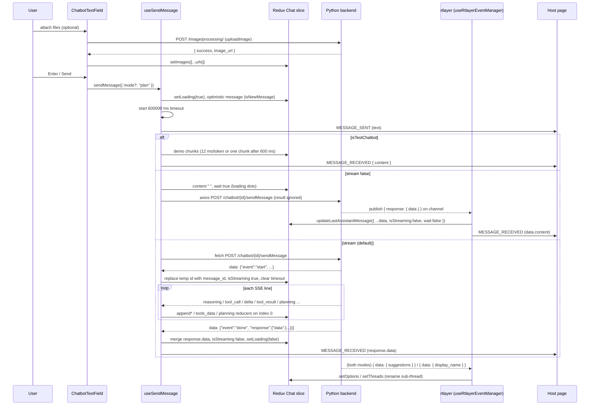

# Flow: ai-message

A user types in the chat box and presses Send (or Enter). The iframe adds an optimistic message to the Redux `Chat` slice, POSTs the message to the GTWY Python backend, and renders the reply as it arrives: as a server-sent-event (SSE) stream over `fetch` when the bridge streams, or as one rtlayer WebSocket payload when it does not. The flow ends when the reply message has `isStreaming: false` and `wait: false`, and `Chat.loading` is false.

Module detail lives elsewhere. This page is the end-to-end trace.
- Send hook, SSE event table, rtlayer payload table, `Chat` state shape: [ai-chat](../modules/ai-chat.md).
- How a message is split into user and assistant cards, and what each card shows: [chat-ui](../modules/chat-ui.md).
- Markdown vs richUI vs legacy Grid dispatch: [rich-ui-renderer](../modules/rich-ui-renderer.md#which-renderer-a-message-gets-assistantmessagetsx).



## Steps

1. **Attach files (optional)** — `components/Interface-Chatbot/ChatbotTextField.tsx:handleImageUpload`
   Images need `appInfo.image_model` or `vision`; PDFs need `image_model`. Rejects files over `MAX_UPLOAD_SIZE_MB` (10), video/audio, and more than `MAX_IMAGES` (4) images. Each file goes to `config/api.ts:uploadImage` (`POST {NEXT_PUBLIC_PYTHON_API_BASE_URL}/image/processing/`, multipart field `image`, through the axios interceptor). The returned `image_url`s are appended to `Chat.images` with `setImages`.
2. **Send** — `components/Interface-Chatbot/ChatbotTextField.tsx:handleSendMessage`
   Enter without Shift, or the Send button. Disabled while `Chat.loading`, uploading, a plan is executing, the box is empty with no images, or a PDF is attached with no text. Adds `{ mode: "plan" }` when `appInfo.mode === true`, `appInfo.isStream === true` and the mode picker is on "planning". Other entry points call the same hook: `components/Interface-Chatbot/Messages/StarterQuestions.tsx`, follow-up chips in `ChatbotTextField.tsx`, richUI `reply` actions and plan buttons in `components/Interface-Chatbot/Messages/AssistantMessage.tsx`, and host `askAi` in `components/Chatbot/hooks/useChatEffects.ts`.
3. **Prepare** — `components/Chatbot/hooks/useChatActions.ts:useSendMessage`
   `setNewMessage(true)` (scroll to bottom), `setError(null)`. Text is the argument or `messageRef.current.value`, trimmed. `Chat.images` is split by extension: `.pdf` → `files`, the rest → `images`. Returns early if there is no text and no image. Clears the input, `setLoading(true)`, `setOptions([])`, clears `images`.
4. **Optimistic message and timeout** — same function, `startTimeoutTimer` and `updateLastAssistantMessage`
   Skipped for inline plan requests (approve/execute, revise with `skipUserEcho`, `respond`). Otherwise a 600 000 ms timer is started and `{ id: tempMessageId, role: "assistant", user, user_urls, content: "", wait: true, isNewMessage: true }` is prepended to `Chat.messageIds[subThreadId]` (index 0 = newest). One message object carries both the user turn and the reply.
5. **Build payload, notify host** — same function
   Shape in [Data at key hops](#data-at-key-hops). `emitEventToParent('MESSAGE_SENT', payload.message)`.
6. **Branch on mode** — same function
   `appInfo.isTestChatbot` → step 7. `appInfo.stream` is `false` or `"false"` → step 8. Anything else (including `undefined` before subscribe answers) → step 9.
7. **Test chatbot (no network)** — `utils/demoChatbotData.ts:getDemoResponse`, `utils/demoChatbotData.ts:isStreamingDemoRequest`
   Replaces index 0 with `{ id: "demo-<ms>", isStreaming: true, content: "" }`. Text containing "stream" is appended token by token every 12 ms; other text is appended as one chunk after 600 ms ("table"/"card" return richUI JSON). Then `finish_reason: "stop"`, `MESSAGE_RECEIVED { content }`, `setLoading(false)`, and `getDemoFollowUpSuggestions` fills `Chat.options`.
8. **Non-stream send** — `config/api.ts:sendDataToAction`
   First sets index 0 to `content: " ", wait: true` so `Message.tsx` renders the assistant card with the loading dots. Then axios `POST {PYTHON_URL}/chatbot/{chatBotId}/sendMessage`. The return value is ignored; the reply comes over rtlayer (step 11).
9. **Stream send** — `config/api.ts:streamDataToAction`
   Raw `fetch` with `Authorization` read from sessionStorage `interfaceToken` (not the axios interceptor). Non-2xx → `{ success: false, error: detail.error || detail }`. Otherwise reads `response.body`, splits on `\n`, and for every line starting with `data: ` calls `onEvent(JSON.parse(rest))`. Other SSE fields (`event:`, `id:`) and unparsable lines are skipped. Returns `{ success: true }` when the body ends.
10. **Handle each SSE event** — `onEvent` switch in `useSendMessage`
    Full table in [ai-chat](../modules/ai-chat.md#sending-usesendmessage). The main path for a normal (non-plan) send:
    - `start`: clear the timeout; `updateLastAssistantMessage({ id: message_id, isStreaming: true, wait: false, content: "" })` replaces the temp id and keeps `user`.
    - `reasoning` → `appendReasoningChunk`; `tool_call` → `appendToolCall` (status `calling`) and sets `isToolCallPending`; `tool_result` → `updateToolResult` (status `done`), clears the flag, emits `TOOL_CALL_RESULT`.
    - `delta`: dropped while a tool call is pending, dropped if it parses to `{ event: "synthesizer_chunk" }` or `{ message_to_user }`, sent to the plan buffer if it looks like plan JSON (`"state"` plus `"planning"` or `"tasks"`), else `appendLastAssistantMessageChunk`.
    - `planning`, `execution`, `task_delta`, `task_reasoning`, plan JSON inside `delta` → `setPlanningData` / `updatePlanningExecutionState` (planning cards).
    - `review_phase` → `setReviewData`; deltas during `reviewer_start` go to `appendReviewDelta`.
    - `done`: merge `response.data` into index 0 with `isStreaming: false`, `wait: false`, `message_id`, `finish_reason`, plus `image_urls`/`llm_urls` from `response.data.image_urls`. Emit `MESSAGE_RECEIVED` with `response.data`, `setLoading(false)`. Paused plans and plan executions take their own branches first.
    - `error`: see [Errors](#errors).
11. **rtlayer listener (both modes)** — `components/Chatbot/hooks/useRtlayerEventManager.tsx:handleMessageRTLayer`
    Listens on `(chatSessionId + (threadId || userId) + (subThreadId || userId))` with spaces turned into `_`. First match wins (table in [ai-chat](../modules/ai-chat.md#receiving-over-rtlayer-usertlayereventmanager)). For this flow:
    - `response.data.suggestions` → `setOptions` (follow-up chips; `ChatbotTextField` shows the first 3).
    - `response.data.display_name` → `setThreads({ newThreadData: data, threadId: data.thread_id })`. `store/interface/interfaceReducer.ts:setThreads` replaces the top sub-thread if `sub_thread_id` matches (dropping the "New Chat" placeholder and its `newChat` flag), else prepends it. `store/appInfo/appInfoSlice.ts` switches `subThreadId` to it.
    - `response.function_call` → a `wait: true` placeholder "Running " with the tool `Name[]` (non-stream tool progress).
    - any other `response.data` → `updateLastAssistantMessage({ ...data, id: data.id || message_id || generateNewId(), isStreaming: false, wait: false })`, emit `MESSAGE_RECEIVED` with `data.content`, `setLoading(false)`, clear the timeout. This is the non-stream reply.
12. **Render** — `components/Interface-Chatbot/Messages/MessageList.tsx`, `components/Interface-Chatbot/Messages/Message.tsx`, `components/Interface-Chatbot/Messages/AssistantMessage.tsx`
    `MessageList` reads `Chat.messageIds[Chat.subThreadId]` and keeps the view pinned to the bottom while `isStreaming` (unless the user scrolled up). `Message` shows the user card from `user` and the assistant card only when there is `content`, `llm_message`, `error`, `planning` or `isStreaming`. `AssistantMessageCard` shows, in order: the `wait` loader, the timeout notice, images, reasoning/working accordion, plan Q&A and task cards, tool-call accordion, review accordion, then the content through markdown, richUI or Grid. Copy and feedback buttons appear once `wait`, `isStreaming`, `timeOut` and `error` are all false (feedback also needs `message_id`). Details: [chat-ui](../modules/chat-ui.md#assistantmessagecard-render-order).

## Data at key hops

Send payload (`useSendMessage`, step 5). Same body for both transports:

```ts
{
  message: string,                     // trimmed text
  images: string[],                    // uploaded non-PDF urls
  files: string[],                     // uploaded .pdf urls
  userId: string | null,               // appInfo.userId
  flag: boolean,                       // stream && !image_model
  interfaceContextData: object,        // { ...Interface.interfaceContext[bridge].variables, ...customVariables }
  threadId: string,                    // customThreadId || appInfo.threadId ("" if empty)
  subThreadId: string,                 // always appInfo.subThreadId
  slugName: string,                    // customBridgeSlug || appInfo.bridgeName
  thread_flag: boolean,                // first message of the default sub-thread or of a "New Chat"
  chatBotId: string,                   // chatSessionId; also in the URL
  version_id: string | null,           // "null" -> null
  action?: "approve" | "execute" | "respond", mode?: "plan", task_id?: string,
  service?: string,                    // model switcher
  configuration?: { model?: string, mcp_config?: { servers: any[] } }
}
```

SSE lines the parser accepts (keys from `config/api.ts:StreamEvent`; values are examples):

```text
data: {"event":"start","message_id":"m_123","model":"gpt-4o","service":"openai"}
data: {"event":"reasoning","content":"The user wants..."}
data: {"event":"tool_call","call_id":"call_1","name":"get_weather","args":{"city":"Pune"}}
data: {"event":"delta","content":"Let me check"}            <- dropped: tool call pending
data: {"event":"tool_result","call_id":"call_1","content":{"temp":31}}
data: {"event":"delta","content":"It is 31°C in Pune."}
data: {"event":"done","message_id":"m_123","finish_reason":"stop","usage":{},"response":{"data":{"content":"It is 31°C in Pune.","image_urls":[]}}}
data: {"event":"error","error":"{\"message_to_user\":\"Model unavailable\"}","message_id":"m_123"}
```

Plan-mode `delta` content may itself be JSON with an `event` key: `execution_started`, `task_started`, `task_completed`, `task_failed`, `task_error`, `task_waiting_for_user`, `plan_paused`, `synthesizer_start`, `synthesizer_chunk`, `synthesizer_done`, or the plain text `running`.

rtlayer payloads read in step 11 (keys the code reads):

```json
{ "response": { "data": { "id": "…", "role": "assistant", "content": "…", "message_id": "…" } } }
{ "response": { "data": { "suggestions": ["…", "…"] } } }
{ "response": { "data": { "display_name": "Trip ideas", "thread_id": "…", "sub_thread_id": "…" } } }
{ "response": { "function_call": true, "Name": ["get_weather"], "message": "optional text" } }
{ "event": "error", "error": "…", "fallback_error": "…", "message_id": "…" }
```

The message object at index 0 through a streamed reply:

```ts
// after step 4 (stream path)
{ id: "<tempId>", role: "assistant", user: "hi", user_urls: [], content: "", wait: true, isNewMessage: true }
// after start
{ id: "m_123", role: "assistant", user: "hi", user_urls: [], content: "", wait: false, isStreaming: true }
// after done
{ id: "m_123", message_id: "m_123", user: "hi", content: "It is 31°C…", reasoning?, tools_data?, isStreaming: false, wait: false, finish_reason: "stop", ...response.data }
```

## Errors

| Where | Condition | What the user sees | Host event |
|---|---|---|---|
| `uploadImage` | upload request fails | "Something went wrong!" toast, then "Failed to upload images" (`uploadImage` returns `null`, and `response.success` then throws) | none |
| `streamDataToAction` | HTTP not ok | `defaultErrorMessage` on index 0 if set; else `removeMessages({ numberOfMessages: 2 })` | `{ status }` |
| `streamDataToAction` | `fetch` throws (network, CORS) | same as above | `{ message }` |
| SSE `error` event | backend error mid-stream | index 0 gets `content` = `defaultErrorMessage` or `message_to_user` from the error JSON or the raw error, plus `error` (both skipped if a review phase ran); plan state `error` in plan mode | `{ message_id: <whole event object>, error }` |
| `sendDataToAction` | axios fails | nothing in the bubble: loading dots until an rtlayer error or the 10-minute timeout; the interceptor adds a "Server Error" toast on 5xx | `{ message, status, statusText, data }` |
| rtlayer `event: "error"` or top-level `error` | backend error (non-stream) | `defaultErrorMessage` or the error text on index 0; loading stops | the error string |
| timeout | no `start` (stream) or no rtlayer reply (non-stream) within 600 000 ms | "Timeout reached. Please try again later." | none |

`defaultErrorMessage` comes from `appInfo` (host config). The raw error is kept in `Chat.error` and `message.error`.

> [!WARNING]
> The non-stream path ignores the result of `sendDataToAction`. A failed POST leaves the bubble loading for up to 10 minutes. The axios interceptor also retries once on a network error (no response), which can deliver the same message twice.

> [!WARNING]
> In stream mode the timeout is cleared on `start` and never restarted. If the stream body ends without a `done` or `error` event, `streamDataToAction` still returns `{ success: true }`, so `loading` stays true and the message stays `isStreaming: true` until reload.

> [!WARNING]
> With `defaultErrorMessage` unset, a failed stream call removes the two newest ids. One id holds both the user turn and the reply, so the previous turn disappears too.

> [!WARNING]
> `MESSAGE_RECEIVED` carries different shapes per path: the whole `response.data` object (SSE `done`), only `data.content` or `{}` (rtlayer), or `{ content }` (test mode). The SSE `error` event sends the whole event object under the key `message_id`. Host listeners must handle all of them.

## Side effects

- Network: `POST {NEXT_PUBLIC_PYTHON_API_BASE_URL}/image/processing/` per attached file; one `POST {NEXT_PUBLIC_PYTHON_API_BASE_URL}/chatbot/{chatBotId}/sendMessage` per send (two if the interceptor retries). The rtlayer socket is already open (created in `useWebSocketClient`); this flow only reads from it. Routes: [api](../api.md). Env vars: [environment](../environment.md).
- Redux: `Chat` (not persisted, not cross-tab synced) for the message, `loading`, `options`, `images`, `error`. On `display_name`: `Interface[…].interfaceContext[bridge].threadList[threadId]` and `appInfo[tabSessionId].subThreadId`.
- Host `postMessage` (`utils/emitEventsToParent/emitEventsToParent.tsx:emitEventToParent`, target `*`):

| When | `type` | `data` |
|---|---|---|
| step 5 | `MESSAGE_SENT` | the text |
| SSE `tool_result`, rtlayer `tool_result` or `function_call` + `result` | `TOOL_CALL_RESULT` | the tool output |
| SSE `done`, rtlayer final data, test mode | `MESSAGE_RECEIVED` | see warning above |
| any error row in [Errors](#errors) | `MESSAGE_RECEIVED_WITH_ERROR` | see table |

The full outgoing event list is in [api](../api.md).

## Footguns

> [!WARNING]
> Nothing aborts a stream (`useSendMessage` passes no `signal`). Every streaming reducer writes to index 0 of `state.Chat.subThreadId` at dispatch time. If the user switches chat mid-reply (`components/Interface-Chatbot/ChatbotDrawerParts/Sidebar.tsx:handleChangeSubThread` also calls `setLoading(false)`), the remaining deltas, tool calls and the final `done` land in the newly opened chat's newest message.

> [!WARNING]
> Switching sub-thread mid-reply on the **non-stream** path is worse: the rtlayer effect cleanup removes the old channel listener and clears the 10-minute timeout, so the reply is never received in this session. It appears only when history for that chat is reloaded.

> [!WARNING]
> `askAi` from the host can pass `threadId` and `bridgeName`. They change only `threadId` and `slugName` in the payload. The optimistic message, the rtlayer channel and the stream reducers still use the current `appInfo` ids.

> [!WARNING]
> On the stream path the optimistic message has `content: ""` and no `isStreaming`, so `Message.tsx` renders only the user card until `start` arrives: there is no "thinking" indicator in that gap. The non-stream path sets `content: " "` (a space) on purpose so the assistant card and its `wait` loader render.

> [!WARNING]
> The transport is chosen by `appInfo.stream` (written by `useSubscribeChatbotDetails`, which overwrites any host value; see [ai-chat](../modules/ai-chat.md#gotchas)), but the backend's `flag` is `stream && !image_model`. An image-model bridge with streaming on is called over SSE with `flag: false`. The planning-mode toggle reads a third field, `appInfo.isStream`.

> [!WARNING]
> `display_name` over rtlayer always moves `appInfo.subThreadId` to that sub-thread. A user who opened another chat before the name arrived is pulled back.

> [!TODO] Needs a human: in stream mode, does the Python backend also publish the final reply or `start`/`delta` on rtlayer? If yes, the rtlayer catch-all rewrites the message a second time, and rtlayer `delta`s are appended without tool-call suppression.

## Changing it safely

- A new SSE event needs a member in `StreamEvent`, a `case` in the `onEvent` switch, and a `setLoading(false)` plus timeout clear on every terminal path. Recipe and constraints: [ai-chat](../modules/ai-chat.md#changing-it-safely).
- Keep each SSE event on one `data: ` line. The parser splits on `\n` and parses each line on its own.
- Check by hand: send with a stream bridge and watch one `sendMessage` request of type `text/event-stream` and the tokens appear; with `stream` false, watch the reply arrive on the WebSocket; in a new chat, see the drawer entry renamed; load with `test_chatbot="true"` and send "Show me streaming".
