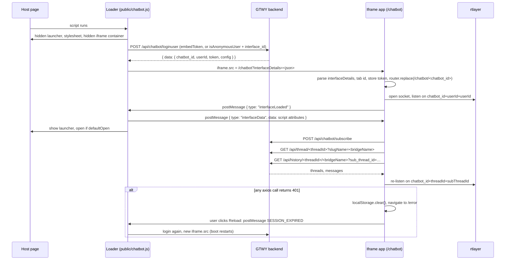

# Flow: widget-boot

A host page includes `<script id="chatbot-main-script" src=".../chatbot.js">`. The loader logs in, mounts a hidden iframe at `/chatbot?interfaceDetails=…`, and the iframe app boots until the chat shows the thread list and the first page of history. Everything below happens in the background, before the user opens the widget.

Loader internals, the script-tag attributes and the `-dev` / `-local` copies of the loader are in [embed-scripts](../modules/embed-scripts.md). Routes, providers and session keys are in [app-shell](../modules/app-shell.md). Thread, history and rtlayer details are in [ai-chat](../modules/ai-chat.md). Message and window-API tables are in [api](../api.md).



## Steps

### Host side

1. **Loader starts.** `public/chatbot.js:initializeChatbot` creates one `ChatbotEmbedManager`. `loadContent` runs on `DOMContentLoaded`, or at once if `<body>` exists. The `bodyLoaded` flag stops a second run.
2. **DOM setup.** `createChatbotIcon` appends the launcher `#interfaceEmbed` with `display: none`. `createStyleLink` adds the stylesheet. `extractScriptProps` reads the attributes into `state.tempDataToSend`. `createIframeContainer` appends `#iframe-parent-container` (`display: none`) holding the iframe, which has no `src` yet.
3. **Login.** `fetchChatbotDetails`:
   - `test_chatbot="true"` → `buildDemoChatbotDetails`. No network call. It returns `chatbot_id: "demo-chatbot"`, `userId: "demo-user"`, `token: null`.
   - `embedToken` set → `POST <login>` with header `Authorization: <embedToken>`.
   - otherwise → anonymous body `{isAnonymousUser: true, interface_id}`, read from the `interface_id` attribute.
   - Up to 4 attempts, 1 s apart. Only thrown errors are retried (network failure, or a body that is not JSON). An HTTP error that has a JSON body is returned as if it were a success.
4. **Iframe URL.** `processChatbotDetails` sets `iframe.src = <chatbotUrl>?interfaceDetails=<encodeURIComponent(JSON.stringify(response.data))>`, then `applyConfig` lays out the container from `response.data.config`. The prod URLs are hard-coded in the constructor (`this.urls`). The env copies of the loader differ only there: see [Env copies](../modules/embed-scripts.md#env-copies-and-drift).
5. **Attributes applied on the host.** `loadContent` then calls `updateProps(tempDataToSend)` (`fullScreen`, `hideIcon`, `iconColor`, `hideCloseButton`).

### Iframe: first document (`/chatbot`)

6. **Providers.** `app/layout.tsx` → `components/AppWrapper.tsx` (Redux `Provider` → `PersistGate` → MUI theme → `ThemeContext`). `PersistGate` holds rendering until `persist:root` (localStorage) and `persist:appInfo` (sessionStorage) rehydrate. AppWrapper's first render reads sessionStorage through `GetSessionStorageData`. That first read caches the embed namespace `<chatbot_id>_<userId>` from the URL (`utils/embedNamespace.ts:getEmbedNamespace`) while `interfaceDetails` is still in the URL.
7. **Parse `interfaceDetails`.** `app/chatbot/layout.tsx:ChatbotLayout` (wrapped by `addUrlDataHoc`) parses the query once, in a `useMemo` with empty deps. A missing value, the string `"undefined"`, or invalid JSON all give `chatbot_id: null`. `?env=stage` sets `environment: 'stage'` in `ChatbotContext`. Nothing reads that value now (see Gotchas).
8. **Tab id.** `app/chatbot/page.tsx:InterfaceEmbed`'s first effect runs before the layout's effects, because it is a child. It reuses sessionStorage `tab_session_id` (a reload) or generates `${Date.now()}_${random7}` and claims it on BroadcastChannel `tab_session_sync`. It then dispatches `setDataInDraftReducer({ tabSessionId })`. Details: [Session keys](../modules/app-shell.md#session-keys).
9. **Layout writes appInfo.** When `chatbot_id && userId`, the layout effect dispatches `setDataInAppInfoReducer({ chatBotId, userId, config, isTestChatbot, defaultErrorMessage?, mcpConfig? })`. When `config` has `allowModalSwitch`, `models` or `defaultModel`, it also dispatches `setDataInInterfaceRedux`. `onConfigChange(config)` applies `themeColor` and `theme`. A `chatbotTheme` stored in the session wins over `config.theme`.
10. **Verify.** `token` present → sessionStorage `interfaceToken` and `interfaceUserId` are stored, and the state becomes `VERIFIED`. No token but `test_chatbot` → only `interfaceUserId` is stored, and the state is `VERIFIED`. Neither → the spinner stays forever. Nothing sets `NOT_VERIFIED`.
11. **Route.** When verified, the page dispatches `setDataInDraftReducer({ chatbotId, chatSessionId: chatbot_id })` and calls `router.replace('/chatbot/<chatbot_id>')`. This is a client navigation: `app/chatbot/layout.tsx` stays mounted, so the parsed values survive even though the query string is gone. The layout effect runs again (its deps include `chatSessionId`) and writes appInfo under the final composite key.

### Iframe: `/chatbot/[chatbotId]`

12. **Wrapper.** `app/chatbot/[chatbotId]/page.tsx` renders `components/Chatbot-Wrapper/ChatbotWrapper.tsx`. `addUrlDataHoc` injects `chatSessionId` and the composite `tabSessionId = ${chatSessionId}_${rawTabId}`. `ChatbotWithHooks` mounts the CORE listeners (`useEmbeddingScriptEventHandler`, `useLocalStorageEventHandler`). It renders `components/Chatbot/Chatbot.tsx` only when `chatSessionId` is set.
13. **Chatbot mounts, before the handshake.** Child effects run first, so these run before step 14:
    - `useHandleGtwyEmbeddingScriptEvents` registers `interfaceData` in the registry. The CORE `message` listener is attached.
    - `components/Chatbot/hooks/useRtlayerEventManager.tsx:useWebSocketClient` opens the rtlayer socket. The keys are hard-coded there; do not copy them. Once the client exists, it listens on `chatSessionId + (threadId || userId) + (subThreadId || userId)`. At this point that is `chatbot_id + userId + userId`, because `threadId` is not known yet.
    - `useReduxEffects` copies `threadId`, `subThreadId`, `bridgeName` (default `"root"`), `versionId` and `headerButtons` from appInfo and Interface into the `Chat` slice.
    - The first `Chatbot` effect opens the drawer on large screens. It checks `!currentChatId`, and nothing ever writes `currentChatId`.
    - `useChatEffects` effects do nothing yet, because `bridgeName` and `threadId` are empty. On a reload of the same tab they are not empty: `persist:appInfo` brings them back, so the fetches in step 16 start here.
14. **Handshake.** `ChatbotWrapper` posts `{type: "interfaceLoaded"}` to `window.parent` inside `setTimeout(0)`, with targetOrigin `"*"`.
15. **Host replies.** `public/chatbot.js:handleIncomingMessages` accepts the message only if `event.origin` is trusted. `sendInitialData` then:
    - shows the launcher (unless `hideIcon`);
    - posts `{type: "interfaceData", data: tempDataToSend}`;
    - calls `openChatbot()` if `defaultOpen`;
    - sets `tempDataToSend = null`.
16. **`interfaceData` → Redux.** `hooks/GTWY/eventHandlers/embeddingScript/embeddingScriptEventHandler.ts` dispatches each field. For boot, the important ones are `threadId`, `bridgeName` (+ `variables` → `addDefaultContext`), `version_id`, `theme`, `headerButtons`, `eventsToSubscribe` and `config` (component overrides). Full field map: [embed-scripts](../modules/embed-scripts.md#messages-this-area-handles-or-sends).
17. **Data fetches.** `components/Chatbot/hooks/useChatEffects.ts:useChatEffects` reacts to the new `threadId` and `bridgeName`. The calls go through `config/api.ts`, using the axios instance in `utils/interceptor.ts` with `Authorization: <interfaceToken>`:
    - `bridgeName` set → `useSubscribeChatbotDetails` → `getSubscribeChatbotDetailsApi` (`POST {NEXT_PUBLIC_API_BASE_URL}/api/chatbot/subscribe`). The response goes to `subscribeData` and to appInfo (`stream`, `files`, `vision`, `image_model`, `supportedServices`, `helloId`). It then calls `getServiceModelsApi` once per supported service, which feeds `setServiceModels`.
    - `threadId && bridgeName` → `useFetchAllThreads` → `getAllThreadsApi` (`GET …/api/thread/<threadId>?slugName=<bridgeName>`) → `setThreads`. The `Interface` reducer stores the list (an empty list becomes one synthetic thread). The appInfo extra reducer in `store/appInfo/appInfoSlice.ts` picks `subThreadId`.
    - every change of `threadId`, `bridgeName` or `subThreadId` → `useGetInitialChatHistory` → `getPreviousMessage(threadId, bridgeName, 1, subThreadId)` (`GET …/api/history/<threadId>/<bridgeName>?sub_thread_id=<subThreadId || threadId>&pageNo=1&limit=40`) → `setInitialMessages`, `setData({currentPage, hasMoreMessages})`, and `setStarterQuestions` when the response has them. `Chat.chatsLoading` drives the progress bar.
18. **Second history call.** On a first boot `subThreadId` starts empty, so the first history call uses `threadId`. When `setThreads` then sets `subThreadId`, the effect fires again. The module-level `AbortController` in `getPreviousMessage` aborts the first call if it is still in flight. rtlayer re-subscribes on the final channel.
19. **First render with history.** `Chatbot.tsx` shows `EmptyChatView` (default message, starter questions) when `messageIds[subThreadId]` is empty, and `ActiveChatView` (`MessageList` + text field) otherwise. The drawer lists the threads. Rendering: [chat-ui](../modules/chat-ui.md).

### Branch: test chatbot (`test_chatbot="true"`)

- Step 3 skips login. `interfaceDetails` carries `token: null` and `test_chatbot: true`.
- Step 10 verifies without a token, so the `interfaceToken` sessionStorage key is not written.
- `useChatEffects` sees `isTestChatbot`. It skips subscribe, the thread list and history. It sets `threadId = demo-thread-<chatSessionId>` and `subThreadId = demo-subthread-<chatSessionId>`, `DEMO_STARTER_QUESTIONS`, and an empty message list. Replies come from `utils/demoChatbotData.ts` (see [Test-chatbot mode](../modules/ai-chat.md#test-chatbot-mode)). rtlayer still connects.

### Branch: `?env=stage`

- `ChatbotLayout` puts `environment: 'stage'` into `ChatbotContext` when the iframe URL has `env=stage`. No GTWY loader adds that parameter, and no component reads `environment`. It was added for the Hello integration (f22beab), and the code that used it was removed in abed550. API calls use `NEXT_PUBLIC_API_BASE_URL` whatever the value of `env` ([environment](../environment.md)).

## Data at key hops

Login response, as the loader reads it (the backend owns the shape; only these keys are used):

```json
{ "data": { "chatbot_id": "…", "userId": "…", "token": "<embed JWT>", "config": { "type": "popup", "themeColor": "#…", "theme": "system" } } }
```

`interfaceDetails` = `response.data`, URL-encoded. The test-mode version: `{"chatbot_id":"demo-chatbot","userId":"demo-user","token":null,"test_chatbot":true,"config":{…,"test_chatbot":true}}`.

`interfaceData` message (host → iframe), built from script attributes (JSON attributes already parsed):

```json
{ "type": "interfaceData",
  "data": { "embedToken": "…", "bridgeName": "support_bot", "threadId": "user-42", "variables": { "plan": "pro" },
            "config": { "type": "popup", "width": "480" }, "defaultOpen": "false", "theme": "system" } }
```

Redux after a normal boot (`<rawTab>` = `tab_session_id`, composite = `<chatbot_id>_<rawTab>`):

```json
{
  "draftData": { "chatSessionId": "<chatbot_id>", "chatbotId": "<chatbot_id>", "tabSessionId": "<rawTab>", "widgetToken": "", "isChatbotMinimized": false },
  "appInfo": {
    "_<rawTab>": { "chatBotId": "…", "userId": "…", "config": {}, "isTestChatbot": false },
    "<chatbot_id>_<rawTab>": { "chatBotId": "…", "userId": "…", "config": {}, "isTestChatbot": false,
      "threadId": "user-42", "bridgeName": "support_bot", "subThreadId": "user-42",
      "stream": true, "isStream": true, "files": false, "vision": false, "image_model": false, "supportedServices": [], "helloId": null }
  },
  "Interface": { "<chatbot_id>_<chatbot_id>_<rawTab>": { "interfaceContext": { "support_bot": { "variables": {}, "threadList": { "user-42": [] } } }, "headerButtons": [] } }
}
```

The `"_<rawTab>"` entry is real. The layout effect first runs before `chatSessionId` exists, and that write lands under `_` + raw tab id. Nothing reads it.

## Errors

| Where | What happens | What the user sees |
|---|---|---|
| Login throws 4 times | `loadChatbotEmbed` logs the error. The iframe never gets a `src` | No launcher (unless `hideIcon="false"` was set, which shows a launcher that opens an empty frame) |
| Login returns an error JSON | `response.data` is undefined, so the URL becomes `interfaceDetails=undefined`, which parses to null ids. Not verified, no `interfaceLoaded` | No launcher, as above |
| No token and no `test_chatbot` | `InterfaceEmbed` stays `VERIFYING` | Spinner if opened. Launcher hidden |
| axios 401 (`utils/interceptor.ts`) | `removeCookie`, `localStorage.clear()`, iframe navigates to `/error?error=session+expired` | "Session Expired" card. **Reload Page** posts `SESSION_EXPIRED`; **Close** posts `CLOSE_CHATBOT` |
| axios ≥ 500 | `errorToast("Server Error, Try again later")`, then rejects. The history hook falls back to an empty list | Toast, empty chat |
| axios no response | Retried once (`_retry`), then `isNetworkError` | Empty history or thread list |
| `getAllThreadsApi` error | `errorToast(message or "Something went wrong While fetching Threads!")` | Toast, no thread list |
| Subscribe error | Logged, returns `null`. Stream, files and vision stay at their defaults | Nothing visible |

**Re-login after `SESSION_EXPIRED`** (`app/error/page.tsx` → `public/chatbot.js:loadChatbotEmbed`): the loader logs in again and sets a new `iframe.src`, so steps 6–19 run again in the same iframe. Only localStorage was cleared. The iframe's sessionStorage (`tab_session_id`, `interfaceToken`, `persist:appInfo`) survives, so as long as `chatbot_id` and `userId` are unchanged, appInfo rehydrates `threadId` and `bridgeName`, and history reloads without the host's help. `Interface` (`variables`, `headerButtons`, `eventsToSubscribe`, `modalConfig`) and component overrides lived in localStorage `persist:root`, so they are gone. The host does not re-send them, because of the warning below.

> [!WARNING]
> **`tempDataToSend` is set to `null` after the first handshake.** After a re-login, the new `interfaceLoaded` sends only what `SendDataToChatbot` added since then. The original attributes (`bridgeName`, `threadId`, `variables`, `headerButtons`, `config` overrides, `theme`) and `defaultOpen` are not sent again. If a re-boot must restore the full state, rebuild the payload from `this.props` or keep a copy of the attributes in `public/chatbot.js:sendInitialData` (and in both env copies).

> [!TODO] Needs a human: does an anonymous re-login return the same `userId`? If not, the embed namespace changes, `tab_session_id` and `persist:appInfo` are not found, and the re-booted chat has no `threadId` or `bridgeName` at all.

## Side effects

- **Network.** Login (loader); `POST /api/chatbot/subscribe`, `GET /api/service/<service>` per supported service, `GET /api/thread/<threadId>`, `GET /api/history/<threadId>/<bridgeName>` (iframe, base `NEXT_PUBLIC_API_BASE_URL`). An rtlayer WebSocket that is closed on unmount, `pagehide` and `beforeunload`.
- **sessionStorage (iframe origin, scoped `<chatbot_id>_<userId>_`).** `tab_session_id`, `interfaceToken`, `interfaceUserId`, `chatbotTheme` (set or removed by every `interfaceData`). `persist:appInfo` is not scoped.
- **localStorage.** `persist:root` (`Interface`, `subscribeData`, `componentOverrides`), shared by every embed and tab on the origin. `HelloAgentAuth` when subscribe returns `helloId` and `uuid`.
- **BroadcastChannel.** `tab_session_sync` claim (first load of a tab only).
- **Host DOM.** Launcher, stylesheet, container and iframe. The launcher is shown only at the handshake.
- **postMessage.** `interfaceLoaded` (iframe → host); `interfaceData` (host → iframe); when `defaultOpen`, `openChatbot` posts `open` to the iframe (which focuses the text field), to the host's own parent and to `ReactNativeWebView`.

## Gotchas

> [!WARNING]
> **The launcher appears only after the iframe has booted.** `#interfaceEmbed` starts as `display: none`, and `sendInitialData` shows it on `interfaceLoaded`. A broken login, a missing token or a slow iframe all show up as "no chat button", with no error on the host page apart from the console.

> [!WARNING]
> **Order inside the iframe depends on React's effect order.** The `interfaceData` handler and the CORE listener are registered in effects of children of `ChatbotWrapper`, and those effects run before `ChatbotWrapper`'s own effect posts `interfaceLoaded` (in `setTimeout(0)`). If you move the listener up the tree, or post `interfaceLoaded` earlier (for example from `/chatbot` before the redirect), the host's one-time `interfaceData` arrives with no listener and is lost for good, since `tempDataToSend` is then `null`.

> [!WARNING]
> **Messages sent before the handshake are dropped.** `window.askAi`, `setInput` and `reloadChats` post straight to the iframe. `SendDataToChatbot` buffers its fields in `tempDataToSend`, but the replay is sent as `interfaceData`, and that handler ignores `askAi` and `setInput`. Hosts should wait for the chat to open (or for the launcher to show) before calling these.

> [!WARNING]
> **The first-render closure.** `useEmbeddingScriptEventHandler` builds a new registry on every render, but only the first one gets the listener and the `interfaceData` handler (both are registered in `useEffect(..., [])`). The handler keeps the first render's `onConfigChange` and `themeColor`. That is fine for boot. Logic that needs current state should read the store, not the closure.

> [!WARNING]
> **A hard reload of `/chatbot/<chatbot_id>` boots to a blank frame.** The query string is gone and `draftData` is not persisted. `chatSessionId` is therefore empty, and `ChatbotWithHooks` renders nothing, but `ChatbotWrapper` still posts `interfaceLoaded`, and the host has nothing left to send. Only a new `iframe.src` from the loader recovers.

> [!WARNING]
> **A 401 in one embed resets every other embed of the origin.** `localStorage.clear()` fires a `storage` event with `key === null` in the other same-origin documents. `useLocalStorageEventHandler` then resets `draftData` and `appInfo` there (their chat disappears) and emits `RELOAD_PARENT`, which `public/chatbot.js` does not handle.

> [!WARNING]
> **Without `threadId` and `bridgeName` from the host there is no history.** Nothing in the boot path defaults them. The thread list, subscribe and history effects all wait for them, and rtlayer stays on the `userId` channel.

## Changing it safely

- New boot-time option from the host: add it to `extractScriptProps` in all three loader copies, then handle it in the GTWY `handleInterfaceData`. It can also travel in the login `config`, read in `app/chatbot/layout.tsx`. See the recipe candidates in [embed-scripts](../modules/embed-scripts.md#changing-it-safely).
- New per-session value read during boot: write it with `setDataInAppInfoReducer` only after `draftData.tabSessionId` exists, or it lands under the `_<rawTab>` key. Read it with the composite `tabSessionId`.
- Test the four boots by hand: first load, reload of the host tab (session restore), `test_chatbot="true"`, and an expired token (401 → Reload Page).
